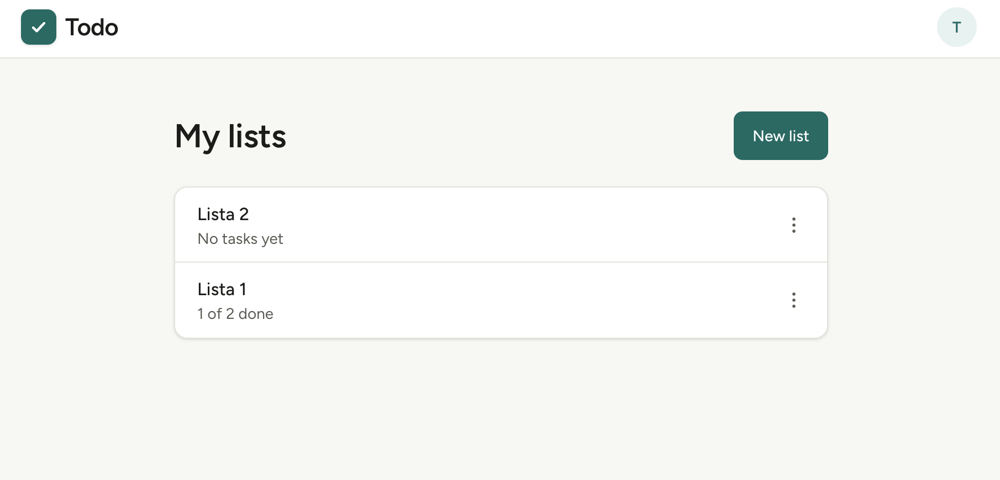

# Shareable TodoList — Serverless on AWS

A minimal todo app with list sharing between users, built as a hands-on study of **AWS architecture (SAA-C03)** and **SRE practices**.

**Live site:** https://d1sa68e9am4aht.cloudfront.net



## Stack
Next.js (static) · S3 + CloudFront · Cognito · API Gateway · Lambda · DynamoDB · GitHub Actions

## Documentation
| Document | Purpose |
|----------|---------|
| [PRD](docs/PRD.md) | Scope, MVP and what is out of scope |
| [Roadmap](docs/ROADMAP.md) | Versions and progress |
| [Architecture](docs/architecture.md) | Diagram, data model, endpoints |
| [ADRs](docs/adr/) | Architecture decisions and trade-offs |
| [Runbooks](docs/runbooks/) | Operations |
| [Postmortems](docs/postmortems/) | Incidents and lessons learned |

## Workflow
Issue (GitHub Projects) → branch `type/n-slug` → PR with `Closes #n` → CI → squash merge → automatic deploy.

## Running locally
```bash
# frontend (first run: copy .env.example to .env.local and fill in the Cognito IDs and the API URL)
cd frontend && npm install && npm run dev
# static export (output goes to frontend/out)
cd frontend && npm run build
# backend (tests)
cd backend && npm install && npm test
```

## Deploying
Every push to `main` is deployed by GitHub Actions (`.github/workflows/deploy.yml`): it tests
and builds both packages, updates the Lambda code, syncs the static export to S3, invalidates
CloudFront and smoke tests the API. AWS access uses OIDC, so no access keys are stored in
GitHub (see ADR-0005). Pull requests run lint, tests and build (`.github/workflows/ci.yml`). The expected
variables and the AWS setup are in the [CI/CD runbook](docs/runbooks/ci-cd.md).

Infrastructure itself is still clickops in v0.1–v0.5 (see ADR-0001).

### Manual fallback
Only for when the pipeline is unavailable; the commands mirror what the workflow runs.

#### Frontend
```bash
cd frontend && npm run build
aws s3 sync out/_next/static s3://todolist-frontend-lp2779/_next/static \
  --cache-control "public,max-age=31536000,immutable"
aws s3 sync out/ s3://todolist-frontend-lp2779/ --delete --exclude "_next/static/*" \
  --cache-control "public,max-age=0,s-maxage=86400"
aws cloudfront create-invalidation --distribution-id E13970XDCS5NZM --paths "/*"
```

#### Backend (Lambda)
`npm run package` bundles each handler with esbuild into `backend/dist/<name>.mjs` and zips it
as `backend/dist/<name>.zip` (`me`, `lists`, `tasks`); each zip is then uploaded to its
`todolist-<name>` function. The HTTP API stage auto-deploys, so nothing has to be redeployed
on the API Gateway side.
```bash
cd backend && npm ci && npm test && npm run package
for name in me lists tasks; do
  aws lambda update-function-code --function-name "todolist-$name" \
    --zip-file "fileb://dist/$name.zip" --region us-east-1
  aws lambda wait function-updated --function-name "todolist-$name" --region us-east-1
done
# smoke test: requests without a token must be rejected by the authorizer
API=https://1vdohdj087.execute-api.us-east-1.amazonaws.com
for route in /me /lists /lists/00000000-0000-0000-0000-000000000000/tasks; do
  curl -s -o /dev/null -w "$route %{http_code}\n" "$API$route"   # expect 401
done
```
