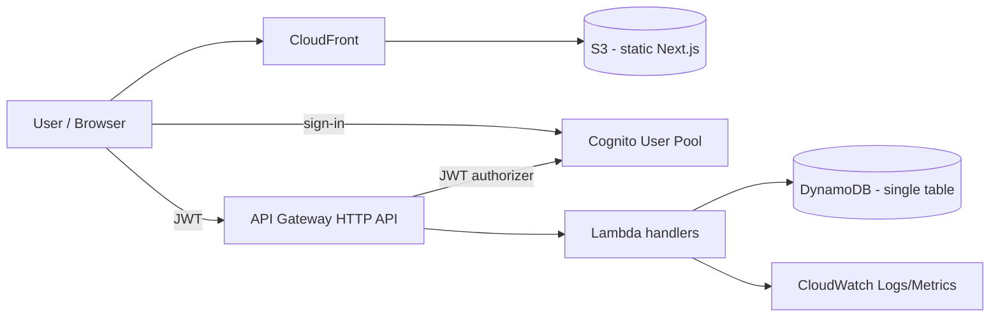

# Architecture

## Overview (MVP target, v0.3)

## Components
| Component | Service | Why |
|-----------|---------|-----|
| Hosting | S3 + CloudFront (OAC) | Static, cheap, HTTPS, caching |
| Auth | Cognito User Pool | Managed, free tier, issues JWTs |
| API | API Gateway HTTP API | Cheaper than REST API, native JWT authorizer |
| Logic | Lambda (Node 24/TS) | Pay-per-use, no servers |
| Data | DynamoDB on-demand | Serverless, free tier, see ADR-0002 |

### Hosting (live, v0.1)
- Private S3 bucket (`todolist-frontend-lp2779`, us-east-1) holds the static export; Block
  Public Access is on and it is never reachable directly, only through CloudFront.
- CloudFront distribution (`d1sa68e9am4aht.cloudfront.net`) reads the bucket through an
  Origin Access Control; the bucket policy grants `s3:GetObject` only to the CloudFront
  service principal, scoped to this distribution's ARN.
- A CloudFront Function (`todolist-index-rewrite`, `infra/cloudfront/index-rewrite.js`) runs
  on viewer-request to append `index.html` to directory-style URIs, since CloudFront's
  default root object only applies to `/`.
- Custom error responses map 403 and 404 to `/404.html` with a 404 status — the Next.js
  static export emits one HTML file per route (not a single SPA `index.html`), so unknown
  paths are served the generated not-found page instead.

### Auth (live, v0.1)
- Cognito User Pool `us-east-1_P1IpEKgOO` (Essentials plan): sign-in by email, required
  `name` attribute, no MFA. App client `todolist-web` is a public SPA client (no secret)
  with `ALLOW_USER_SRP_AUTH` and `ALLOW_REFRESH_TOKEN_AUTH`, token revocation and "prevent
  user existence errors" on (see ADR-0004).
- The frontend is a static export with no server, so `/sign-up`, `/confirm`, `/sign-in` and
  the protected `/app` route run entirely client-side, calling Cognito through Amplify
  Auth v6 (SRP). The User Pool ID and App Client ID come from
  `NEXT_PUBLIC_COGNITO_USER_POOL_ID` / `NEXT_PUBLIC_COGNITO_CLIENT_ID` (`frontend/.env.local`,
  not committed; see `frontend/.env.example`).
- `/app` reads the signed-in user's attributes client-side on mount; if that call fails
  (no valid session) it redirects to `/sign-in`. There is no server-side session check —
  the "protection" is a client-side redirect, consistent with a fully static site.
- Because "prevent user existence errors" is on, Cognito returns the same
  `NotAuthorizedException` for both an unknown email and a wrong password; the sign-in page
  shows one generic "incorrect email or password" message rather than revealing which case
  occurred.

## Data model (draft, see ADR-0002)
| Entity | PK | SK | Attributes |
|--------|----|----|------------|
| List | `LIST#<listId>` | `META` | name, ownerId, createdAt |
| Task | `LIST#<listId>` | `TASK#<taskId>` | title, done, updatedAt |
| Access | `USER#<userId>` | `LIST#<listId>` | role (owner/editor/viewer), listName |

- "My lists and shared with me" = `Query PK = USER#<userId>`
- Open a list = `Query PK = LIST#<listId>`
- Authorization: before any list operation, check for the `USER#<userId> / LIST#<listId>` item.

## Endpoints (planned)
| Method | Route | Version |
|--------|-------|---------|
| GET | /me | v0.1 |
| GET/POST | /lists | v0.2 |
| PATCH/DELETE | /lists/{id} | v0.2 |
| GET/POST | /lists/{id}/tasks | v0.2 |
| PATCH/DELETE | /lists/{id}/tasks/{taskId} | v0.2 |
| POST/DELETE | /lists/{id}/shares | v0.3 |
