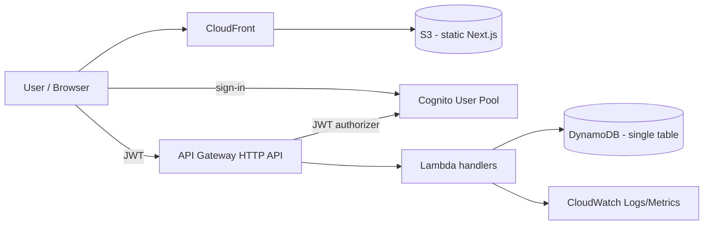

# Architecture

## Overview (MVP target, v0.3)

## Components
| Component | Service | Why |
|-----------|---------|-----|
| Hosting | S3 + CloudFront (OAC) | Static, cheap, HTTPS, caching |
| Auth | Cognito User Pool | Managed, free tier, issues JWTs |
| API | API Gateway HTTP API | Cheaper than REST API, native JWT authorizer |
| Logic | Lambda (Node 20/TS) | Pay-per-use, no servers |
| Data | DynamoDB on-demand | Serverless, free tier, see ADR-0002 |

## Data model (draft, see ADR-0002)
| Entity | PK | SK | Attributes |
|--------|----|----|------------|
| List | `LIST#<listId>` | `META` | name, ownerId, createdAt |
| Task | `LIST#<listId>` | `TASK#<taskId>` | title, done, updatedAt |
| Access | `USER#<userId>` | `LIST#<listId>` | role (owner/editor/viewer), listName |

- "My lists and shared with me" = `Query PK = USER#<userId>`
- Open a list = `Query PK = LIST#<listId>`
- Authorization: before any list operation, check for the `USER#<userId> / LIST#<listId>` item.

## Endpoints (planned)
| Method | Route | Version |
|--------|-------|---------|
| GET | /me | v0.1 |
| GET/POST | /lists | v0.2 |
| PATCH/DELETE | /lists/{id} | v0.2 |
| GET/POST | /lists/{id}/tasks | v0.2 |
| PATCH/DELETE | /lists/{id}/tasks/{taskId} | v0.2 |
| POST/DELETE | /lists/{id}/shares | v0.3 |
