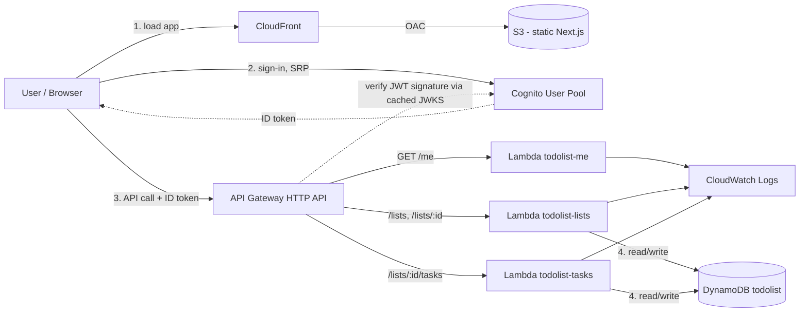
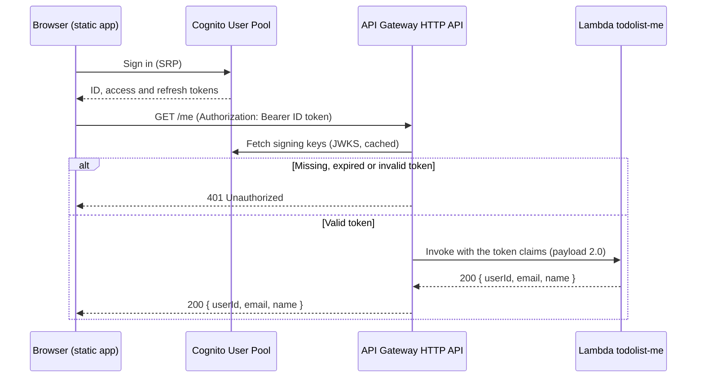
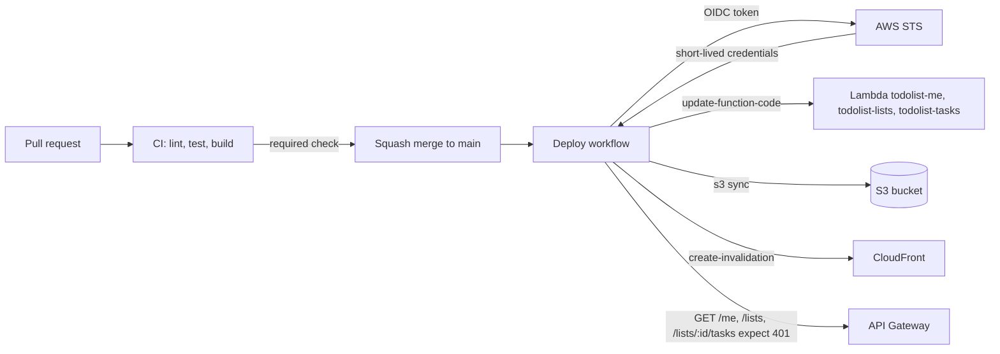

# Architecture

## Overview (live, v0.2)

Dashed arrows are responses or signing-key reads, not calls made on every request: API
Gateway fetches the User Pool's JWKS once and validates each token locally against the cached
keys. `todolist-me` only echoes the validated claims and never touches the table.

Every box above is live and was created by hand in the console (ADR-0001); the full list is in
the [infrastructure inventory](runbooks/infra-inventory.md). One function per resource
(ADR-0006) keeps each one's permissions and blast radius separate. The deploy path has its own
diagram in [CI/CD](#cicd).

## Target (MVP, v0.3)
The MVP keeps the same services. Sharing adds routes and access items on the same table
(ADR-0002), and the installable PWA only adds static files to the existing bucket.

## Components
| Component | Service | Why | Status |
|-----------|---------|-----|--------|
| Hosting | S3 + CloudFront (OAC) | Static, cheap, HTTPS, caching | Live (v0.1) |
| Auth | Cognito User Pool | Managed, free tier, issues JWTs | Live (v0.1) |
| API | API Gateway HTTP API | Cheaper than REST API, native JWT authorizer | Live (v0.1) |
| Logic | Lambda (Node 24/TS), one function per resource | Pay-per-use, no servers, see ADR-0006 | Live (v0.2): `todolist-me`, `todolist-lists`, `todolist-tasks` |
| CI/CD | GitHub Actions + OIDC | No stored AWS keys, see ADR-0005 | Live (v0.1) |
| Cost guardrails | AWS Budgets + Cost Anomaly Detection | Email alerts before spend surprises | Live (v0.1) |
| Data | DynamoDB, provisioned 5 RCU / 5 WCU | Serverless, free tier, see ADR-0002 | Live (v0.2) |

### Hosting (live, v0.1)
- Private S3 bucket (`todolist-frontend-lp2779`, us-east-1) holds the static export; Block
  Public Access is on and it is never reachable directly, only through CloudFront.
- CloudFront distribution (`d1sa68e9am4aht.cloudfront.net`) reads the bucket through an
  Origin Access Control; the bucket policy grants `s3:GetObject` only to the CloudFront
  service principal, scoped to this distribution's ARN.
- A CloudFront Function (`todolist-index-rewrite`, `infra/cloudfront/index-rewrite.js`) runs
  on viewer-request to append `index.html` to directory-style URIs, since CloudFront's
  default root object only applies to `/`.
- Custom error responses map 403 and 404 to `/404.html` with a 404 status — the Next.js
  static export emits one HTML file per route (not a single SPA `index.html`), so unknown
  paths are served the generated not-found page instead.

### Auth (live, v0.1)
- Cognito User Pool `us-east-1_P1IpEKgOO` (Essentials plan): sign-in by email, required
  `name` attribute, no MFA. App client `todolist-web` is a public SPA client (no secret)
  with `ALLOW_USER_SRP_AUTH` and `ALLOW_REFRESH_TOKEN_AUTH`, token revocation and "prevent
  user existence errors" on (see ADR-0004).
- The frontend is a static export with no server, so `/sign-up`, `/confirm`, `/sign-in` and
  the protected `/app` route run entirely client-side, calling Cognito through Amplify
  Auth v6 (SRP). The User Pool ID and App Client ID come from
  `NEXT_PUBLIC_COGNITO_USER_POOL_ID` / `NEXT_PUBLIC_COGNITO_CLIENT_ID` (`frontend/.env.local`,
  not committed; see `frontend/.env.example`).
- Every page uses one session check (`frontend/lib/session.ts`): the user is signed in only
  when `fetchAuthSession()` returns an ID token, after Amplify's own refresh; any failure
  counts as signed out. `/app` pages without a session redirect to `/sign-in`, and
  `/sign-in`, `/sign-up` and `/confirm` with a session redirect to `/app`. Using the same
  check on both sides means the pages can never bounce the user back and forth. There is no
  server-side session check: the "protection" is a client-side redirect, consistent with a
  fully static site, and the API enforces access on every call.
- The top bar's name and email come from the ID token claims, so rendering a page needs no
  network call beyond the API data itself.
- Because "prevent user existence errors" is on, Cognito returns the same
  `NotAuthorizedException` for both an unknown email and a wrong password; the sign-in page
  shows one generic "incorrect email or password" message rather than revealing which case
  occurred.

### API (live since v0.1, lists and tasks since v0.2)

- HTTP API `todolist-api` (`https://1vdohdj087.execute-api.us-east-1.amazonaws.com`), single
  `$default` stage with auto-deploy. An HTTP API was chosen over a REST API because it is
  cheaper and has a native JWT authorizer; nothing here needs REST-only features (usage
  plans, request validation, WAF).
- The `cognito-jwt` authorizer validates the token's signature, expiry, issuer (the User
  Pool) and audience (the `todolist-web` App Client) before the Lambda is invoked. A request
  without a valid token gets a 401 from API Gateway and never reaches the function, so it
  costs no Lambda invocation.
- The frontend sends the Cognito **ID token**, not the access token: only the ID token
  carries the `email` and `name` claims, and its `aud` claim matches the authorizer's
  audience. `GET /me` stays live, but the frontend no longer needs it: it reads the same
  claims from the ID token.
- The Lambda (`todolist-me`, Node.js 24, arm64) only maps the already validated claims to
  the response body, so it calls no AWS API. Its execution role is least privilege: write
  access to its own CloudWatch log group and nothing else.
- CORS is handled by API Gateway, not by the handler: only the CloudFront origin and
  `http://localhost:3000` (local development) are allowed, with the `authorization` and
  `content-type` headers and the GET, POST, PATCH and DELETE methods. `retry-after` is an
  exposed header so the frontend can honor it. API Gateway answers the preflight `OPTIONS`
  request itself, without the authorizer.
- `todolist-lists` and `todolist-tasks` route on `event.routeKey`, check access with a
  `GetItem` on the user's access item before any list operation (no access means 404, the
  same answer as a missing list), validate input with 400 and a user-facing message, and
  answer 503 with `Retry-After` when DynamoDB throttles. Each execution role can only use the
  DynamoDB actions its handler needs, on table `todolist` only.
- A list delete is not atomic (see the data model below), so the frontend retries a
  `DELETE /lists/{id}` that fails with 500 or 503 up to twice, and treats a 404 on a retry as
  success.
- Default route throttling (rate 10 requests/s, burst 20) caps the blast radius of a
  runaway client or abuse while the API is public.
- The API URL comes from `NEXT_PUBLIC_API_URL` (`frontend/.env.local`, not committed; see
  `frontend/.env.example`).

## CI/CD

- **CI** (`.github/workflows/ci.yml`) runs on every pull request and on pushes to `main`, with
  one job per package. It has no AWS access and builds the frontend with placeholder
  configuration.
- **Deploy** (`.github/workflows/deploy.yml`) runs on pushes to `main`, in the `production`
  environment, one run at a time. It builds and tests everything first, then updates the
  code of all three Lambda functions, syncs the static export to S3, invalidates CloudFront and
  finally checks that `GET /me`, `GET /lists` and `GET /lists/{id}/tasks` without a token
  still return 401.
- **No stored AWS keys (ADR-0005).** GitHub issues an OIDC token for the job and AWS STS exchanges it for
  short-lived credentials of a deploy role whose trust policy only accepts this repository's
  `production` environment. The role can only write to the frontend bucket, invalidate the
  distribution and update the code of the three functions.
- **Caching.** Hashed assets under `_next/static/` are uploaded as immutable for one year
  and never deleted by a deploy, so tabs opened on the previous build keep working.
  Everything else is `public,max-age=0,s-maxage=86400`: browsers always revalidate, CloudFront
  keeps the object for a day, and the invalidation at the end of each deploy purges the edge.
- Resource names, IDs and the role ARN come from GitHub Actions variables; see
  [`docs/runbooks/ci-cd.md`](runbooks/ci-cd.md).

## Data model (live, v0.2, see ADR-0002)
Table `todolist`: `PK` (String) + `SK` (String), provisioned 5 RCU / 5 WCU, no indexes.

| Entity | PK | SK | Attributes |
|--------|----|----|------------|
| List | `LIST#<listId>` | `META` | name, ownerId, taskCount, doneCount, createdAt, updatedAt |
| Task | `LIST#<listId>` | `TASK#<taskId>` | title, done, createdAt, updatedAt |
| Access | `USER#<userId>` | `LIST#<listId>` | role (owner, later editor/viewer), createdAt |

- `userId` is the Cognito `sub`; list and task IDs are UUID v4 (ADR-0006).
- My lists = `Query PK = USER#<userId>`, then `BatchGetItem` on the `META` items for name
  and progress.
- Open a list = `Query PK = LIST#<listId>` (`META` and all tasks).
- Authorization: before any list operation, `GetItem USER#<userId> / LIST#<listId>`;
  missing means 404.
- Task create, delete and complete/uncomplete update the `META` counters in the same
  `TransactWriteItems`; a task title edit is a single update on the task. List rename is a
  single update on `META`.
- Lists and tasks are returned newest first (ADR-0006).
- List delete removes `META` first, then the tasks in batches, and the access item last,
  so a failed delete can be retried.

## Endpoints
| Method | Route | Version |
|--------|-------|---------|
| GET | /me | v0.1 (live, `todolist-me`) |
| GET/POST | /lists | v0.2 (live, `todolist-lists`) |
| PATCH/DELETE | /lists/{id} | v0.2 (live, `todolist-lists`) |
| GET/POST | /lists/{id}/tasks | v0.2 (live, `todolist-tasks`) |
| PATCH/DELETE | /lists/{id}/tasks/{taskId} | v0.2 (live, `todolist-tasks`) |
| POST/DELETE | /lists/{id}/shares | v0.3 |
